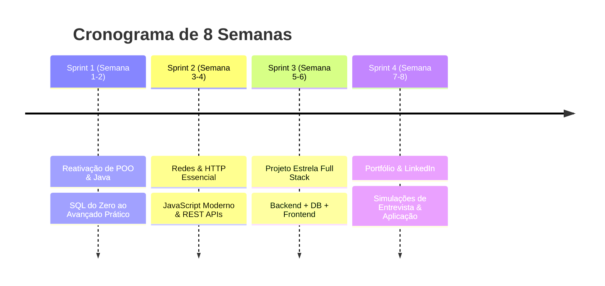

# 🚀 Back to Peak: Plano de Aceleração para Estágio em TI (8 Semanas)

> **Objetivo:** Eliminar a ferrugem técnica, consolidar lacunas (SQL, Web/HTTP, JS), construir 1 projeto de alto impacto e conquistar uma vaga de estágio em TI em até 60 dias.

---

## 🧠 A Regra de Ouro: Como Estudar com IA sem Ficar Dependente

Para recuperar a velocidade e a lógica afiada:

1. **Sessões "Mãos no Teclado" (Sem IA):** Durante os exercícios diários de algoritmos e sintaxe pura, **não use copilotos ou autocomplete inteligente**. Force o cérebro a lembrar a sintaxe, imports e tipos.
2. **IA como Mentora (Não como Digiladora):** Use a IA para:
   - Revisar seu código após você terminar (*Code Review*).
   - Explicar conceitos difíceis com analogias.
   - Simular entrevistas técnicas e testes de empresas.

---

## ⏱️ Estrutura da Rotina Diária Recomendada (2h a 3h/dia)

| Bloco                                | Duração | Foco                        | O que fazer                                                  |
| :----------------------------------- | :-------- | :-------------------------- | :----------------------------------------------------------- |
| **1. Aquecimento Mecânico**   | 30 min    | Lógica & Sintaxe (Zero IA) | 1 a 2 problemas no Beecrowd / LeetCode (Java ou JS/Python)   |
| **2. Teoria Direta ao Ponto**  | 45 min    | Fechar Lacunas              | Vídeos recomendados, documentação e mapas mentais         |
| **3. Prática & Construção** | 1h a 1h30 | Projeto & Aplicação       | Codar o projeto da semana, criar schemas SQL, construir APIs |

---

## 📅 Visão Geral das 8 Semanas

---

## 🗓️ Detalhamento Semanal

### 🔹 MÊS 1: FUNDAÇÃO SÓLIDA E FIM DAS LACUNAS

---

### SEMANA 1: Desbloqueio Mecânico de Sintaxe & POO Forte em Java

* **Meta:** Reativar a fluência em Java e garantir que conceitos avançados de POO (Interfaces, Polimorfismo, Coleções) saiam no automático.
* **Tópicos:**
  - Tipagem estática, Loops, Arrays vs Lists (`ArrayList`, `HashMap`, `HashSet`).
  - POO profunda: Encapsulamento, Herança, Classes Abstratas vs Interfaces, Polimorfismo.
  - Tratamento de Exceções (`try-catch-finally`, Custom Exceptions).
* **Exercício Prático da Semana:**
  - Criar um **Sistema de Gerenciamento Bancário/Estoque via Console em Java puro** (sem Spring ainda). Usar interfaces, polimorfismo e persistência básica em arquivo ou memória.
* **Recursos Recomendados:**
  - 📺 *DevDojo (YouTube)* - Maratona Java Virado no Jiraya (assistir apenas às playlists de POO e Coleções).
  - 💻 *Beecrowd (antigo URI)* ou *LeetCode* - Resolver 10 problemas fáceis/médios em Java.

---

### SEMANA 2: Banco de Dados Relacional (SQL) Sem Medo

* **Meta:** Eliminar a trava com SQL e aprender a modelar, consultar e relacionar dados com naturalidade.
* **Tópicos:**
  - Modelagem Relacional (1:1, 1:N, N:N, Chaves Primárias e Estrangeiras).
  - DDL (CREATE, ALTER, DROP) e DML (INSERT, UPDATE, DELETE).
  - Consultas Avançadas: `WHERE`, `LIKE`, `IN`, `GROUP BY`, `HAVING`, `ORDER BY`.
  - **Joins na veia:** `INNER JOIN`, `LEFT JOIN`, `RIGHT JOIN`.
* l
  - Modelar o banco de dados de um e-commerce ou sistema de biblioteca (5+ tabelas relacionadas).
  - Escrever um script com 15 queries complexas respondendo a perguntas de negócio (ex: "Top 3 clientes que mais gastaram no último mês").
* **Recursos Recomendados:**
  - 📺 *Curso em Vídeo (Gustavo Guanabara)* - Curso de MySQL (direto nas aulas de Joins e Modelagem).
  - 🌐 *SQLZoo / SQLBolt* - Exercícios interativos de SQL direto no navegador.

---

### SEMANA 3: Fundamentos Web (HTML5, CSS Moderno) & Como a Rede Funciona

* **Meta:** Eliminar o medo do Front-end (layout na prática com Flexbox/Grid) e entender como a Web e as requisições HTTP funcionam.
* **Tópicos:**
  - **HTML5 Semântico:** Estrutura limpa (`header`, `nav`, `main`, `section`, `article`, `footer`, `form`).
  - **CSS Moderno Sem Mistério:** Box Model (`margin`, `padding`, `border`), **Flexbox** (alinhamento unidimensional) e **CSS Grid** (alinhamento bidimensional).
  - **Responsividade:** Media Queries básicas para adaptar para celular e desktop.
  - **Redes & HTTP para Devs:** O que é DNS/IP/Porta, Protocolo HTTP/HTTPS, Métodos (`GET`, `POST`, `PUT`, `DELETE`), Status Codes (`200`, `201`, `400`, `404`, `500`), Headers e JSON.
* **Exercício Prático da Semana:**
  - Praticar com os jogos *Flexbox Froggy* e *Grid Garden*.
  - Criar uma **Landing Page de Perfil / Portfólio Pessoal** 100% responsiva em HTML5 + CSS puro (sem frameworks), com layout moderno (dark mode, cards alinhados com Flexbox e Grid).
  - Testar chamadas HTTP no Postman / Insomnia.
* **Recursos Recomendados:**
  - 🐸 *Flexbox Froggy* e 🌻 *Grid Garden* (jogos interativos no navegador).
  - 📺 *Kevin Powell (YouTube)* - "Flexbox/Grid simplified" ou *Origamid* / *Curso em Vídeo* de HTML5/CSS3.
  - 📺 *Fábio Akita* - "Redes de Computadores para Desenvolvedores".

---

### SEMANA 4: JavaScript Moderno, DOM & Assincronismo

* **Meta:** Conectar o HTML/CSS com JavaScript moderno e aprender a consumir dados de APIs externas.
* **Tópicos:**
  - ES6+: `const`/`let`, Arrow Functions, Destructuring, Template Literals, Spread Operator.
  - Métodos de Array: `.map()`, `.filter()`, `.reduce()`, `.find()`, `.forEach()`.
  - Manipulação do DOM (`document.querySelector`, `addEventListener`, criação de elementos dinâmicos).
  - Assincronismo & APIs: `Promises`, `async/await`, `fetch()`.
* **Exercício Prático da Semana:**
  - Integrar a página da Semana 3 com JavaScript: buscar dados de uma API pública (ex: GitHub API ou ViaCEP) e renderizar cards dinâmicos na tela ao clicar em um botão ou preencher um formulário.
* **Recursos Recomendados:**
  - 📺 *Origamid* ou *Rocketseat* - JavaScript ES6+ e Fetch API.
  - 📖 *JavaScript.info* - Seções de DOM e Promises/async-await.

---

### 🔹 MÊS 2: PROJETO DE PORTFÓLIO, PREPARAÇÃO E VAGAS

---

### SEMANAS 5 e 6: Construção do Projeto Estrela (Full Stack / API + DB)

* **Meta:** Desenvolver um projeto completo, arquitetado profissionalmente, que será o centro do seu currículo e das entrevistas.
* **Opção Recomendada (Java + Spring Boot OU Node.js/TypeScript):**
  - **Backend:** API REST em Java Spring Boot (ou Node.js) com CRUD completo, validações e tratamento de erros.
  - **Database:** PostgreSQL ou MySQL integrado via ORM (Spring Data JPA ou Prisma/TypeORM).
  - **Frontend:** Interface limpa em React ou JS moderno consumindo os endpoints.
  - **Arquitetura:** Padrão em camadas (Controller -> Service -> Repository / DTOs).
* **Entregáveis:**
  - [ ] Repositório no GitHub com commits semânticos (`feat:`, `fix:`, `refactor:`).
  - [ ] README profissional com prints, diagrama da arquitetura, instruções de execução e tecnologias usadas.

---

### SEMANA 7: Otimização de Perfil, Currículo e Presença

* **Meta:** Deixar sua vitrine irresistível para recrutadores de estágio.
* **Ações:**
  - **LinkedIn:** Título estratégico (ex: *Estudante de DSM | Java | Spring Boot | SQL | JavaScript*), resumo focado em capacidade de aprendizado e paixão por resolver problemas.
  - **Currículo:** Modelo de 1 página (limpo, padrão ATS), destacando sua formação técnica prévia, faculdade atual e o link dos repositórios com READMEs bem feitos.
  - **GitHub:** Organizar os repositórios públicos, fixar o Projeto Estrela no topo.

---

### SEMANA 8: Treinamento de Entrevistas & Disparo de Candidaturas

* **Meta:** Conquistar entrevistas e passar nos testes com confiança.
* **Ações:**
  - **Simulação de Testes Técnicos:** Resolver questões clássicas de entrevista (Palíndromo, Inversão de String, Two Sum, Queries com Join).
  - **Simulação de Entrevistas Comportamentais:** Treinar respostas no método STAR (Situação, Tarefa, Ação, Resultado) contando sobre seus desafios no técnico e projetos.
  - **Rotina de Aplicação:** Aplicar para **5 a 10 vagas/dia** (LinkedIn, Gupy, Cia de Talentos, Nube, CIEE, sites das empresas).

---

## 📊 Checklist de Progresso

- [X] **Semana 1:** Java & POO Reativados (Projeto Console concluído)
- [ ] **Semana 2:** SQL Dominado (15 queries com Joins resolvidas)
- [ ] **Semana 3:** Redes & HTTP (Testes no Postman concluídos)
- [ ] **Semana 4:** JS Moderno & Async/Fetch Dominados
- [ ] **Semana 5:** Backend da API construído e conectado ao Banco
- [ ] **Semana 6:** Frontend integrado ao Backend e Projeto publicado
- [ ] **Semana 7:** LinkedIn e Currículo 100% atualizados
- [ ] **Semana 8:** Primeiras 50 candidaturas enviadas + Simulações de Entrevista
