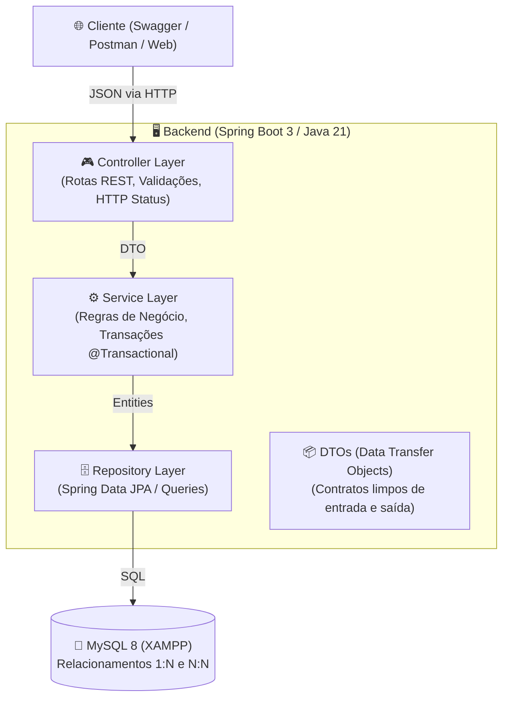
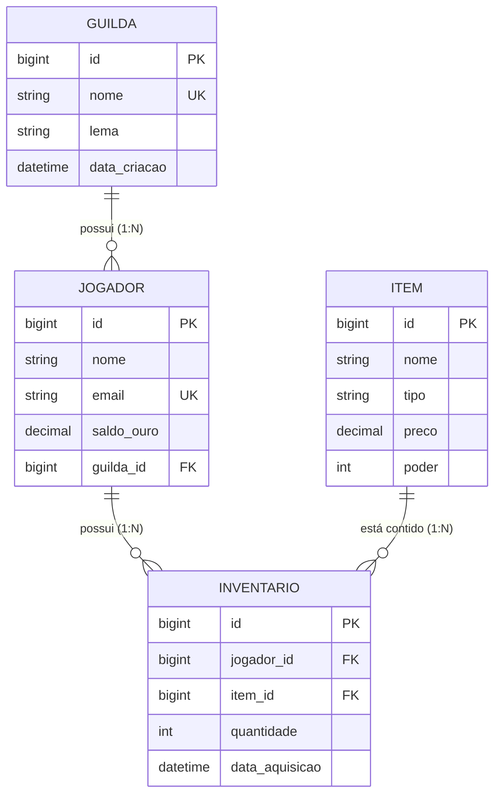

# 🛡️ GameCore API: Arquitetura & Especificação do Projeto Estrela

> **Status:** Documento de Especificação Técnica (RFC/Blueprint)
> **Prazo:** Semanas 05 e 06
> **Foco de Mercado:** Vagas de Estágio e Júnior em TI (Java / Spring Boot / Backend)

---

## 🎯 1. O que É vs. O que NÃO É (Controle de Escopo)

Para garantir que o projeto seja **concluído em 2 semanas com nível máximo de qualidade**, o escopo é rigidamente delimitado:

* ✅ **O que É:** Uma **API REST Corporativa de LiveOps & Economia de Games**. Ela gerencia dados persistentes em banco de dados relacional, regras de negócio transacionais (compra de itens com saldo), segurança de integridade e contratos HTTP padronizados.
* ❌ **O que NÃO É:** NÃO é uma engine de física, NÃO tem gráficos 3D/2D, NÃO tem movimentação em tempo real via WebSockets. É **100% Engenharia de Backend de Alta Fidelidade**.

---

## 🏛️ 2. Arquitetura em Camadas (Enterprise Standard)

O projeto seguirá o padrão arquitetural em camadas adotado pelas maiores empresas de tecnologia:

### Responsabilidade de cada camada:

1. **Controllers:** Apenas recebem a requisição, validam se os campos obrigatórios vieram (`@Valid`) e devolvem o status code correto (`200`, `201`, `204`, `404`, etc.).
2. **Services:** O cérebro do sistema. Onde ficam os `if/else` de negócio: verificar se o jogador tem ouro suficiente, debitar saldo, lançar exceções customizadas.
3. **Repositories:** Interfaces do Spring Data JPA que conversam com o MySQL sem precisarmos escrever SQL na mão.
4. **DTOs:** Protegem o banco. O cliente nunca recebe ou envia a entidade do banco diretamente; tudo passa por DTOs seguros.

---

## 🗄️ 3. Modelo de Dados Relacional (Banco MySQL)

O banco de dados gerenciará **4 entidades principais**:

---

## 🔌 4. Endpoints da API (Contratos REST)

### 👤 Jogadores (`/api/jogadores`)

* `POST /api/jogadores`: Cadastra um novo jogador (Saldo inicial de ouro: 100.00).
* `GET /api/jogadores`: Lista todos os jogadores paginados.
* `GET /api/jogadores/{id}`: Detalha um jogador por ID.
* `PUT /api/jogadores/{id}/guilda/{guildaId}`: Associa um jogador a uma guilda.

### 🛡️ Guildas (`/api/guildas`)

* `POST /api/guildas`: Cria uma nova guilda.
* `GET /api/guildas`: Lista guildas com contagem de membros.
* `GET /api/guildas/{id}`: Detalha a guilda e lista todos os seus membros.

### 🗡️ Loja & Economia (`/api/loja`)

* `GET /api/loja/itens`: Lista o catálogo de itens disponíveis para compra.
* `POST /api/loja/comprar`: **(O Coração do Projeto)**
  - **Payload:** `{ "jogadorId": 1, "itemId": 3 }`
  - **Ação:** Verifica o saldo do jogador. Se tiver ouro suficiente, debita o valor da conta e adiciona o item ao inventário em uma **transação atômica (`@Transactional`)**.
  - **Se não tiver saldo:** Lança `SaldoInsuficienteException` (Retorna `HTTP 400 Bad Request` com mensagem amigável).

---

## 🚨 5. Regras de Negócio de Destaque para Entrevistas

Estas são as 3 perguntas que você vai responder com orgulho para o recrutador:

1. **Transacionalidade:** *"Como você garantiu que o ouro não fosse debitado se a adição do item ao inventário falhasse?"* ➔ Uso da anotação `@Transactional` para rollback automático.
2. **Tratamento Global de Exceções:** Uso de `@ControllerAdvice` para capturar erros e padronizar as respostas em JSON limpos, sem vazar stacktrace de Java para o usuário.
3. **Documentação Swagger / OpenAPI:** Acesso via `/swagger-ui/index.html` para testes interativos no navegador.

---

## 📅 6. Plano de Ação (Semanas 5 e 6)

### 🔹 SEMANA 5: Fundação do Spring Boot & Entidades Básicas

- [ ] Inicialização do projeto Spring Boot 3 (Java 21, Maven, Spring Web, Spring Data JPA, MySQL Driver).
- [ ] Configuração do `application.properties` conectando no MySQL do XAMPP.
- [ ] Criação das Entidades `Jogador` e `Guilda` com relacionamentos JPA (`@OneToMany`, `@ManyToOne`).
- [ ] Criação dos Controllers, Services e Repositories com CRUD de Jogadores e Guildas.

### 🔹 SEMANA 6: Economia, Transações & Polimento de Portfólio

- [ ] Criação da Entidade `Item` e tabela de `Inventario`.
- [ ] Implementação da regra de negócio de Compra com `@Transactional`.
- [ ] Criação das Exceções customizadas e do `GlobalExceptionHandler`.
- [ ] Adição do Swagger / OpenAPI para documentação visual.
- [ ] Conectar a página web da Semana 4 para consumir essa API real!
